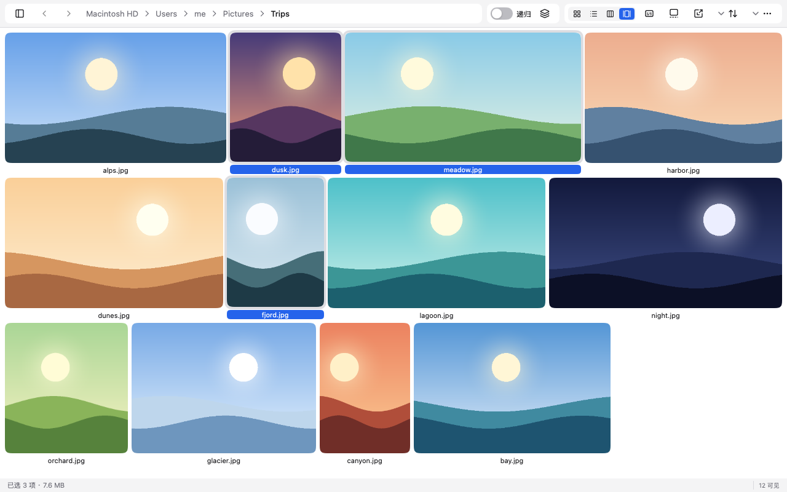
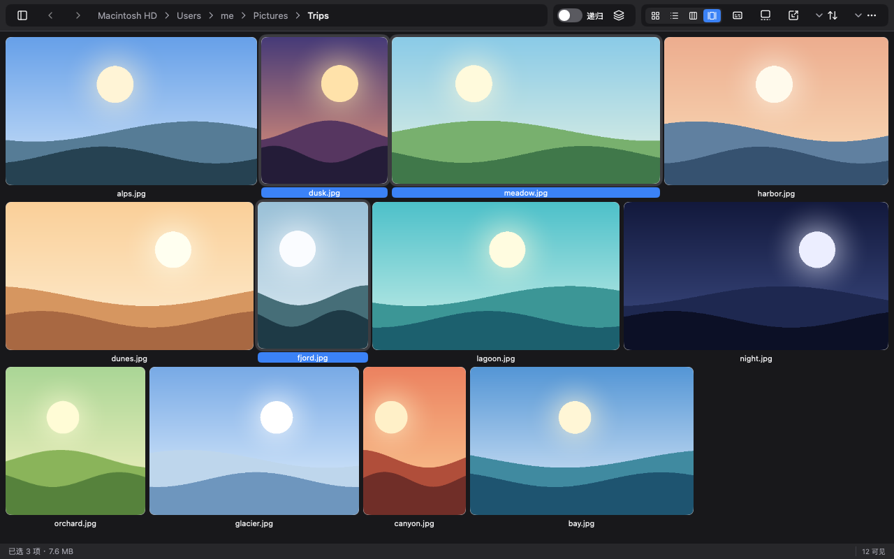
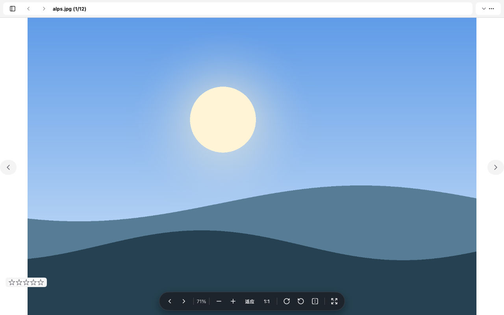
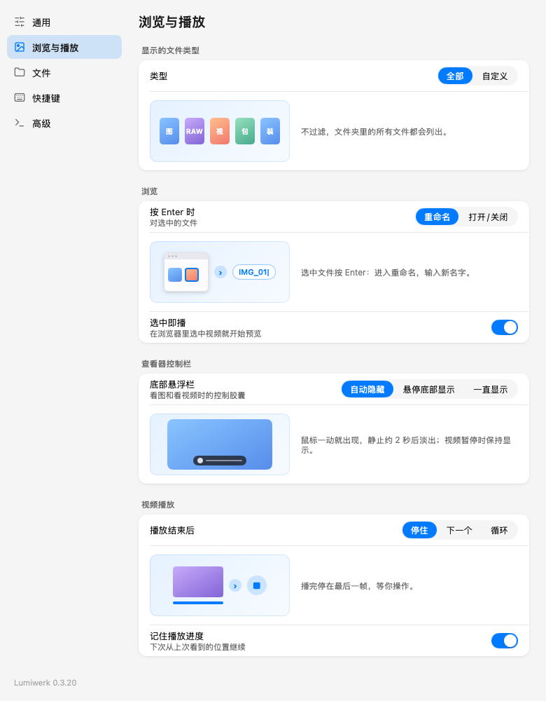

# Lumiwerk

A fast, native media browser for photos and videos. Built with Go and [MyGo](https://github.com/egoist/mygo).

*Lumiwerk* = French *lumière* (light) + German *Werk* (work): light work for browsing media.



> The interface is currently in Simplified Chinese.

## Features

**Browse**
- Four layouts: justified rows, waterfall, uniform grid and a detail list. Thumbnails scale from tiny to large.
- Tabs, history, favorites and a lazy folder tree. Pinyin-aware search and Finder-style sorting.
- Recursive browsing with a depth limit; subfolder names and video durations are marked on the thumbnails.
- Light, dark and system themes.



**Select and act**
- Rubber-band selection: drag on empty space to select files and folders, and use Shift to add or Cmd to toggle.
- One context menu for every surface. Items follow what is selected, and recursive selections work in a single step: copy, move, rename, zip, tag, trash.
- Batch rename with a live preview, undo and redo for file operations, and Finder tags and ratings.

**View**
- A large viewer with pointer-anchored zoom, fit and 1:1, rotate, mirror, and EXIF and file info overlays.
- A floating capsule control bar for images and videos. Choose whether it hides automatically, shows when the pointer nears the bottom edge, or stays up.
- A gallery mode with a thumbnail strip, mixed images and videos, and a progress bar.



**Video**
- Built-in playback with a timeline, speed control, frame capture and trimming. Resume where you left off.
- Covers come from embedded artwork first, then FFmpeg and the system.

**Archives**
- Browse inside ZIP files. Keep a password book and Lumiwerk tries each saved password when extracting.

**Everyday polish**
- A menu bar item with recent folders, a global show/hide hotkey and a Dock policy.
- Thumbnails are cached in memory and on disk, so large folders reopen quickly.
- A diagnostics window (Cmd+Shift+D) with logs, panic counts and a copyable report.



## Install

Download a package from [Releases](https://github.com/mcxen/lumiwerk/releases). Builds exist for macOS (Universal), Windows (x64 and ARM64) and Linux (x64 and ARM64), with SHA-256 checksums. macOS packages use ad-hoc signatures and Windows installers are unsigned. Install FFmpeg separately for video covers and video tools.

## Build

```sh
go build -o /dev/null ./...
go test -count=1 ./...
go run github.com/egoist/mygo/cmd/mygo build -skip-dmg -skip-notarize -o dist
```

The default build leaves out the libmpv backend. Release builds set `GOFLAGS=-tags=mpvbackend`.

Pushing a `v*` tag runs the **Desktop Release** workflow. The tag must match `version` in `mygo.json`.

To refresh the screenshots above from the real views:

```sh
LW_README_SHOTS=$PWD/docs/screenshots go test -run TestReadmeScreenshots ./src
```

## Logs

Lumiwerk writes a rotating log to `~/Library/Logs/Lumiwerk/lumiwerk.log`. Set `LUMIWERK_LOG` to `debug`, `info` (default), `warn`, `error` or `off` to change the level.

## Development

See [AGENTS.md](AGENTS.md) and [docs/development.md](docs/development.md) for the verification gate, the shared UI contracts and the crash-reproduction workflow. Third-party notices are in [THIRD_PARTY_NOTICES.md](THIRD_PARTY_NOTICES.md).
