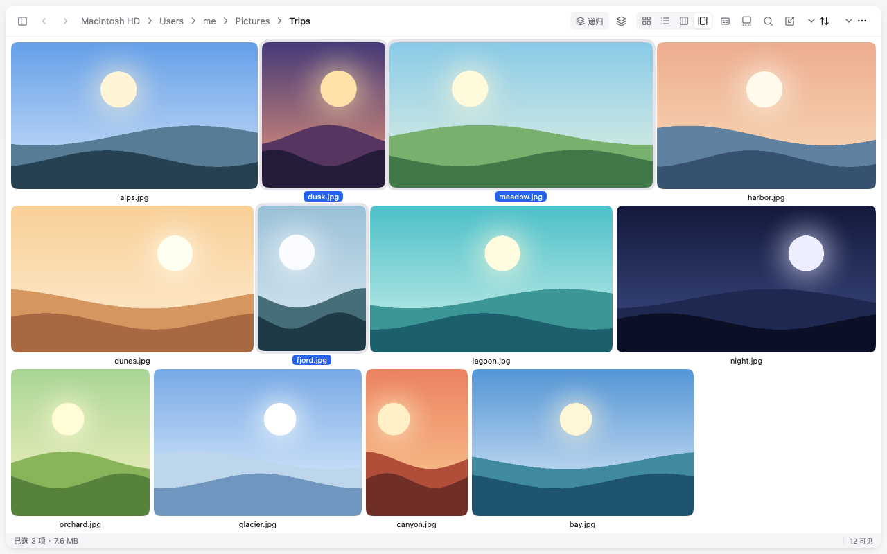
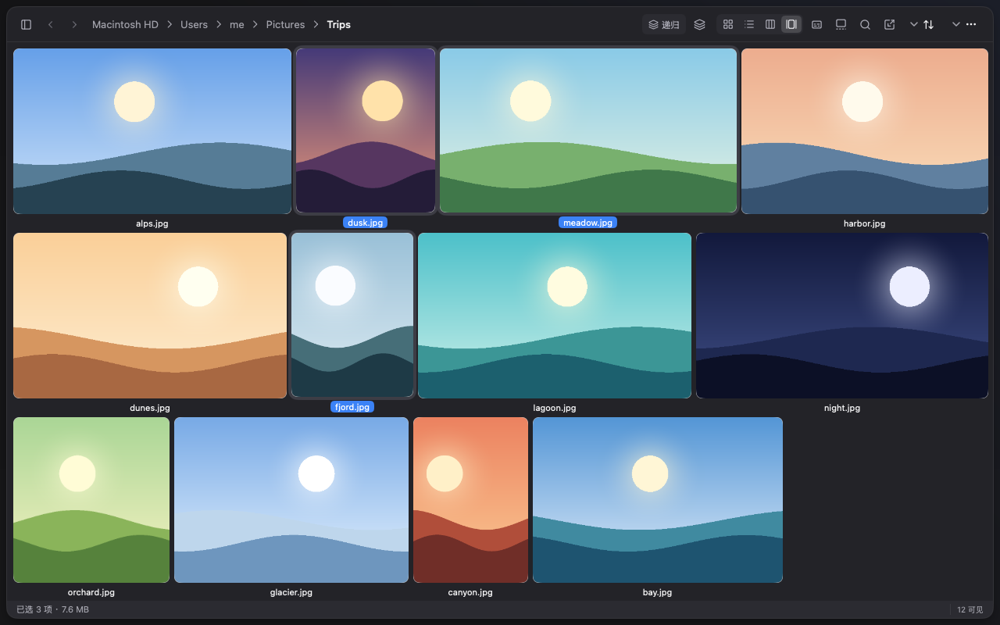
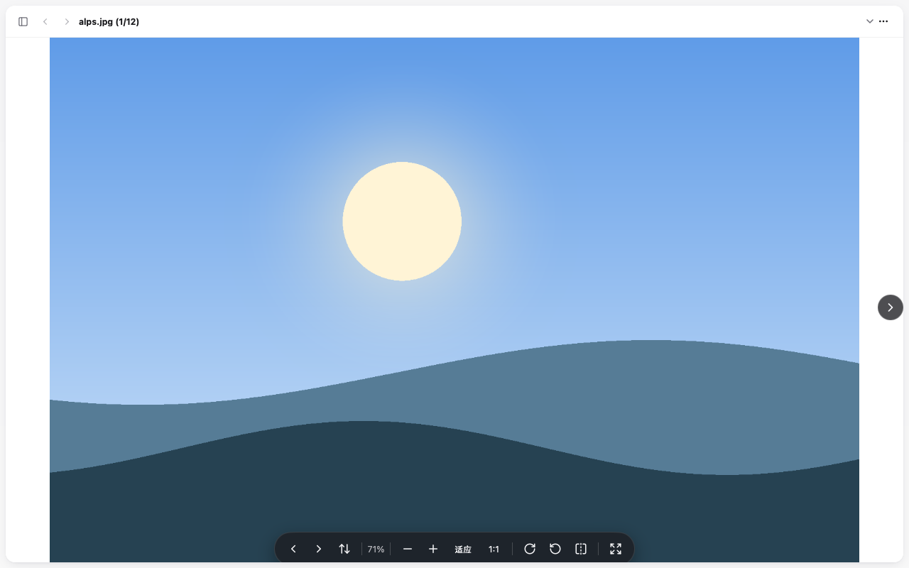
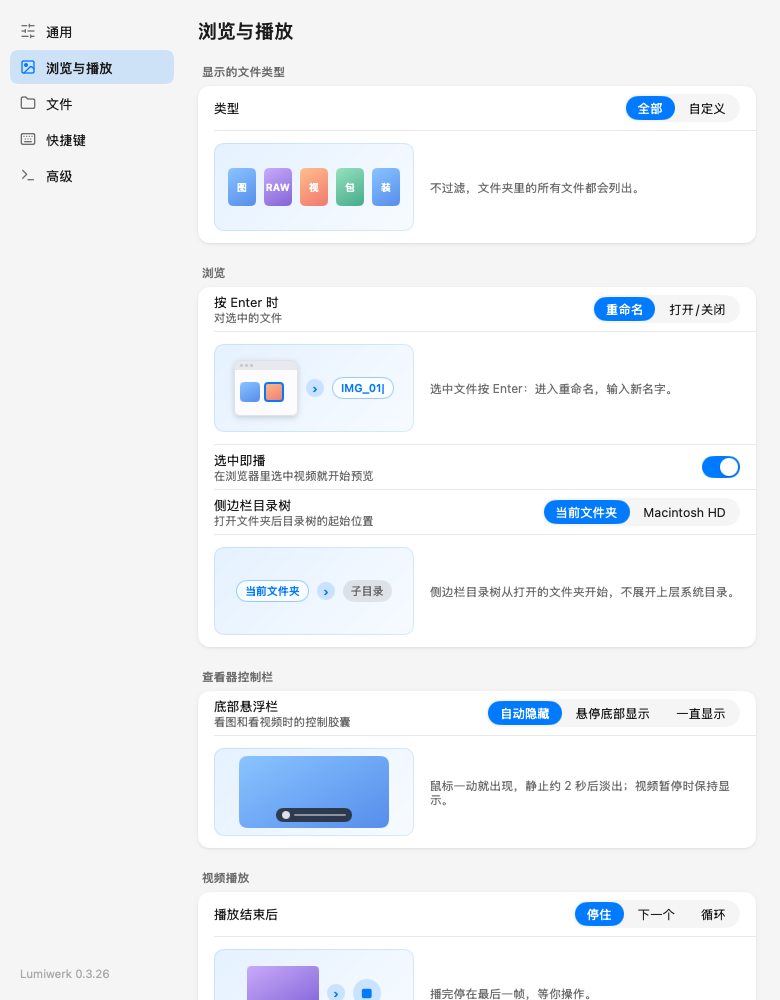

# Lumiwerk

A fast, native media browser for photos, videos, and archives. Built with Go and [MyGo](https://github.com/egoist/mygo).

*Lumiwerk* = French *lumière* (light) + German *Werk* (work): light work for browsing media.



> The interface is currently in Simplified Chinese.

## Features

**Browse**
- Four layouts: justified rows (default), waterfall, uniform grid, and a detail list with sortable columns. Thumbnails scale from 64 to 512 px (`=` / `-` / `0` or slider), with a captionless mode (`Cmd+Shift+H`) that hides filename bands.
- Tabs, back/forward history with visit timestamps, favorites, and a lazy folder tree with volume listing. Pinyin-aware search (`Cmd+F`), Finder-style sorting, type filters (images, RAW, videos, archives, installers), and 9 saved view slots (`Opt+1~9` to switch, `Cmd+Opt+1~9` to save).
- Recursive browsing (`Cmd+Shift+R`) with depth limits (all levels, 1 level, or 2 levels); included folders are marked in the sidebar, subfolder sources appear on waterfall cards, and video durations appear on thumbnails.
- Light, dark, and system themes paired with 7 window background washes (*paper*, *mist*, *meadow*, *dusk*, *tide*, *apricot*, *plain*) framing a rounded content card, plus right-drag / `W`/`A`/`S`/`D` folder navigation and incremental auto-refresh.



**Select and act**
- Rubber-band selection: drag on empty space in any layout to select files and folders, with edge auto-scroll, `Shift` to extend, and `Cmd` to toggle.
- Unified context menu across cards, blank space, and the viewer: open, reveal in Finder/Explorer/file manager, file info, copy, cut, paste, inline rename (`F2`), batch rename with live preview (or rename by parent folder name), copy/move to configured folders, cross-folder ZIP compression (with optional encryption), trash, and undo/redo (`Cmd+Z` / `Cmd+Shift+Z`).
- Drag-and-drop files onto folders, Finder tags (extended attributes on macOS, JSON tag store on Windows/Linux), Open With (macOS/Windows), and Share (macOS).

**View**
- Large viewer with shared-element open/close transition, pointer-anchored zoom (fit and 1:1), drag pan, rotate (`Q`/`E`), mirror, and EXIF/file info overlays (`I` / `U` / `Cmd+I`). Supports PNG, JPEG, GIF, WebP, BMP, TIFF, ICO, HEIC/HEIF, AVIF, and camera RAW formats.
- Floating capsule control bar for images and videos, configurable to auto-hide, show on bottom hover, or stay visible—and lifting automatically in gallery mode so it never covers the bottom strip.
- Immersive gallery mode (`G`) with a rounded thumbnail strip (`H` pins it), mixed images and videos, slideshow playback, and a draggable bottom progress bar.



**Video**
- Built-in playback powered by bundled `libmpv` (with an FFmpeg fallback) featuring timeline seek, speed control (`0.25x–4x`), frame stepping, screenshot capture, timeline trimming and cropping, end-of-playback actions (stop, next, loop), and resume where you left off. Optional autoplay when selecting videos in the browser.
- Covers come from embedded artwork first (including MP4/MOV and MKV attachments), then FFmpeg, macOS QuickLook, and `libmpv`; MP4/MOV/MKV/WebM metadata is parsed in pure Go with `ffprobe` as fallback.

**Archives**
- Open ZIP, CBZ, RAR, CBR, 7Z, CB7, TAR, LZH, CAB, and ISO archives directly as folders with thumbnails and the large view—no pre-extraction needed. Entries extract on demand to cache and remain read-only (extract to modify).
- Seamless archive-to-archive reading: advancing past the last page opens the next archive in the directory, and stepping back from the first page returns to the previous one.
- Continuous vertical reading (`W`): stacks all pages into a single width-fitted column for webtoons and long scans.
- Save multiple passwords in the Settings password book to try them automatically when browsing or extracting encrypted archives.

**Everyday polish**
- Menu bar / tray icon with a status panel, recent folders, favorites, active task and playback controls, a global show/hide hotkey (`Cmd+Opt+L`), close-to-tray, Dock visibility policy, and launch at login.
- Two-tier thumbnail cache (configurable memory LRU and persistent `bbolt` disk cache) so large folders reopen quickly, with one-click cache cleanup in Settings.
- Rebindable keyboard shortcuts in Settings, in-app updater (with GitHub / `tvv.tw` mirror source selection), and a diagnostics window (`Cmd+Shift+D`) with logs, panic counts, runtime stats, and a copyable report.



## Install

Download a package from [Releases](https://github.com/mcxen/lumiwerk/releases). Builds exist for macOS (Universal `.dmg`), Windows (x64 and ARM64 `.exe` installers and `.tar.gz`), and Linux (x64 and ARM64 `.deb` and `.tar.gz`), with `SHA256SUMS` checksums. macOS packages use ad-hoc signatures and Windows installers are unsigned.

Built-in video playback uses bundled `libmpv` on macOS and Windows (Linux uses system `libmpv` or the FFmpeg fallback). Install FFmpeg separately for video trimming/cropping/exporting and FFmpeg fallback covers/playback.

## Build

```sh
go build -o /dev/null ./...
go vet ./...
go test -count=1 ./...
go run github.com/egoist/mygo/cmd/mygo build -skip-dmg -skip-notarize -o dist
```

The default build leaves out `gen2brain/go-mpv` (its package init panics when `libmpv` is missing). Release builds set `GOFLAGS=-tags=mpvbackend` and bundle `libmpv`.

Pushing a `v*` tag runs the **Desktop Release** workflow. The tag must match `version` in `mygo.json`.

To refresh the screenshots above from the real views:

```sh
LW_README_SHOTS=$PWD/docs/screenshots go test -run TestReadmeScreenshots ./src
```

## Logs

Lumiwerk writes a rotating log to `~/Library/Logs/Lumiwerk/lumiwerk.log`. Set `LUMIWERK_LOG` to `debug`, `info` (default), `warn`, `error`, or `off` to change the level.

## Development

See [AGENTS.md](AGENTS.md), [docs/development.md](docs/development.md), and [docs/UISPEC.md](docs/UISPEC.md) for the verification gate, shared UI contracts, layout specifications, and the crash-reproduction workflow. Third-party notices are in [THIRD_PARTY_NOTICES.md](THIRD_PARTY_NOTICES.md).
